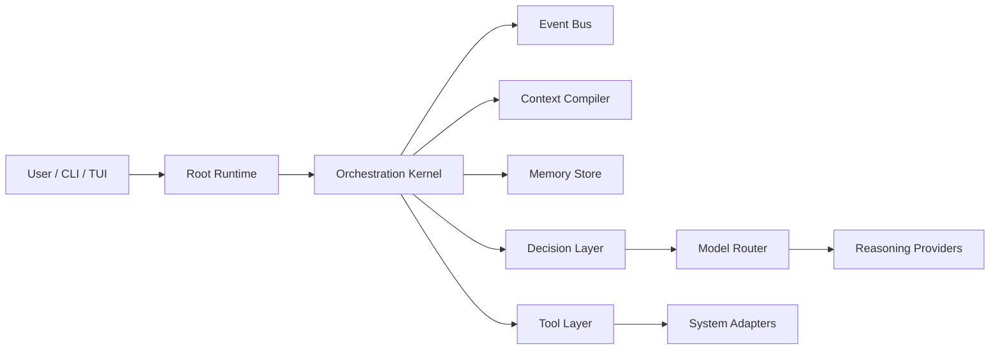

# Wyvern Architecture

This document defines the intended technical boundaries of Wyvern. It is deliberately narrower than the README and focuses on component separation rather than product vision.

## System Overview

Wyvern is a deterministic orchestration kernel wrapped around recursive runtime instances. The kernel coordinates missions, runtimes, events, context compilation, scoped memory, tool access, and model routing.

## Component Boundaries

### Orchestration Kernel

Owns runtime creation, parent/child hierarchy, lifecycle transitions, mission tracking, scheduling, cancellation, and persistence coordination.

The kernel must remain deterministic wherever possible. It should not depend on an LLM for lifecycle management or state transitions.

### Runtime

A runtime is an execution instance of an agent definition against a specific objective and context.

Minimum runtime metadata will eventually include:

- runtime ID
- parent runtime ID
- mission ID
- agent definition
- objective
- lifecycle state
- status
- capabilities
- permissions
- model policy
- decision policy
- child-runtime permissions
- events
- artifacts
- timestamps
- structured output contract

### Agent Definitions

Agents are reusable capability roles. They define what a runtime is allowed to do, what skills it may load, and what output contract it must satisfy.

Agents are not themselves runtimes.

### Decision Layer

Decision-making is separate from reasoning. The decision layer handles frequent low-cost control flow, such as continue, wait, retry, spawn, skip, escalate, or terminate.

The planned Laya integration belongs here.

### Model Router

The model router selects a reasoning provider according to policy. The runtime engine should not hard-code a single model or provider.

The router may eventually support policies such as:

- cheap / fast reasoning
- complex reasoning
- coding
- vision
- research
- security reasoning
- local inference
- cloud inference

### Context Compiler

The context compiler constructs task-specific projections from relevant state.

It should consider:

- parent and runtime objectives
- branch and mission state
- prior attempts and findings
- relevant artifacts
- constraints
- capabilities and permissions
- relevant memory
- child results

It should exclude unrelated global state unless explicitly justified.

### Memory System

Memory is scoped and provenance-aware. It should preserve source runtime, confidence where relevant, and artifact references.

Expected scopes:

- runtime
- branch
- mission
- reusable knowledge

### Event System

The event system provides the coordination backbone for state propagation, live views, observability, and recovery.

Events are intended to support:

- parent reactions to child results
- live UI updates
- runtime recovery
- audit trails
- asynchronous coordination

### Tool Layer

Tools are controlled interfaces to external capabilities. Runtimes should not couple directly to the raw OS or to individual applications.

Initial tools are expected to include:

- filesystem
- terminal
- process execution

Later tools will add browser, tabs, IDE control, application control, screenshots, security tooling, HTTP, and OS APIs.

### System Adapters

OS-specific behavior belongs behind adapters.

Expected adapter family:

- WindowsAdapter
- LinuxAdapter
- future WyvernOSAdapter

### TUI

The TUI is a view over orchestration state, not a second control plane.

It should subscribe to runtime and event state and render:

- missions
- runtime tree
- agent status
- event stream
- resource usage
- model activity
- command input

## Lifecycle

Planned runtime lifecycle states:

- CREATED
- CONTEXT_LOADING
- READY
- RUNNING
- WAITING
- BLOCKED
- RETRYING
- COMPLETED
- FAILED
- CANCELLED

The lifecycle should be asynchronous and event-driven.

## Data Flow

1. A user command creates or updates a mission.
2. The kernel instantiates a runtime from an agent definition.
3. The context compiler constructs the runtime's task-specific projection.
4. The decision layer selects whether to continue, wait, spawn, or escalate.
5. The model router is queried only when reasoning is required.
6. Tools and/or child runtimes are invoked through controlled abstractions.
7. Events, artifacts, and memory updates flow back to the parent runtime.
8. The parent synthesizes the result and propagates only relevant state upward.

## Persistence

The Stage 1 runtime kernel persists missions, runtimes, and structured results in SQLite, and Stage 1A adds restart hydration to reload persisted state into the in-memory registries.

Persisted records include:

- missions
- runtimes
- events
- artifacts
- scoped memory entries
- runtime state snapshots or checkpoints when later added

SQLite with SQLx is the current initial direction.

## Unresolved Decisions

The following remain intentionally unresolved and should be documented as the implementation matures:

- exact runtime state schema
- exact event payload schema
- checkpoint representation
- artifact storage model
- memory indexing strategy
- model provider registry shape
- skill package format
- security boundary enforcement details
- TUI layout specifics
- adapter interface exactness

## Non-Goals for the Initial Kernel

The initial architecture does not include:

- a custom model
- a kernel or OS
- distributed infrastructure
- direct unrestricted machine control
- broad app-specific integrations before the abstraction layer exists

## Stage 1 Implementation Notes

The implemented kernel is intentionally small and deterministic.

Current implementation choices:

- strongly typed Mission, Runtime, and Agent IDs backed by UUID v7 values with human-readable prefixes for CLI output
- in-memory runtime and mission registries for active state
- SQLite persistence as the durable source of record
- restart hydration from SQLite into live registries
- broadcast-based event distribution for runtime lifecycle notifications
- cancellation-aware execution and lifecycle validation
- a deterministic demo executor that proves recursive asynchronous execution without LLM involvement
- agent definitions stored separately from runtime instances, with execution behavior still fixed by the stage-1 demo recipe rather than model reasoning

## Stage 2 Implementation Notes

- `Runtime` remains the machine execution/lifecycle record; `RuntimeContext` is a separate typed projection with inherited items, local facts, relevant event envelopes, selected child outputs, constraints, and metadata.
- `ContextCompiler::compile` is deterministic and side-effect-free. Callers select all inherited context, events, and child outputs explicitly.
- Context is stored by runtime ID, scoped to its mission, and written to SQLite alongside immutable versioned snapshots. Context updates are serialized per runtime; separate runtime branches can update independently.
- Child context starts empty. Downward inheritance copies selected parent facts, and upward result propagation writes only to the direct parent when explicitly requested.
- `EventBus` remains a live broadcast mechanism. A second subscription surface delivers envelopes with event IDs and routing fields while the original event subscription remains compatible.
- Persistent event history is not implemented; event envelopes are live notifications, while context and snapshots are durable records.
