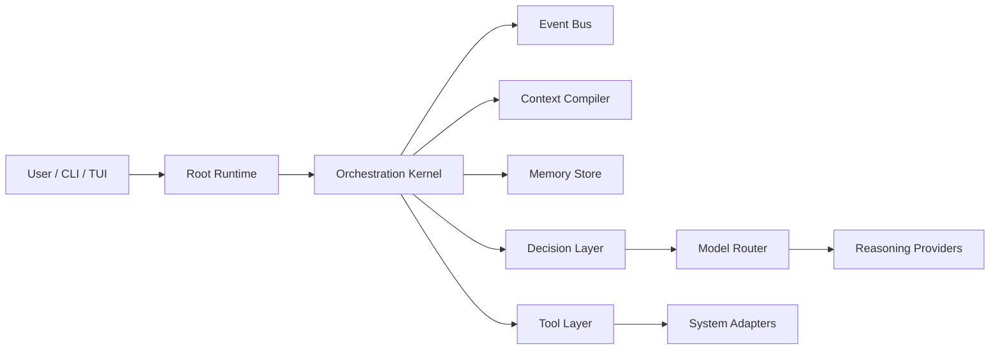

# Wyvern Architecture

This document defines the intended technical boundaries of Wyvern. It is deliberately narrower than the README and focuses on component separation rather than product vision.

## System Overview

Wyvern is a deterministic orchestration kernel wrapped around recursive runtime instances. The kernel coordinates missions, runtimes, events, context compilation, scoped memory, tool access, and model routing.

## Component Boundaries

### Orchestration Kernel

Owns runtime creation, parent/child hierarchy, lifecycle transitions, mission tracking, scheduling, cancellation, and persistence coordination.

The kernel must remain deterministic wherever possible. It should not depend on an LLM for lifecycle management or state transitions.

The first real capability is `filesystem.read`. A process-local registration supplies its workspace root and maximum file size; the executor canonicalizes both the root and target, rejects traversal and escapes through symlinks, requires a regular file, and returns structured UTF-8 or binary data. Requests still require a kernel-issued authorization grant and use the existing capability lifecycle events, timeout, cancellation, and audit path.

### Runtime

A runtime is an execution instance of an agent definition against a specific objective and context.

Minimum runtime metadata will eventually include:

- runtime ID
- parent runtime ID
- mission ID
- agent definition
- objective
- lifecycle state
- status
- capabilities
- permissions
- model policy
- decision policy
- child-runtime permissions
- events
- artifacts
- timestamps
- structured output contract

### Agent Definitions

Agents are reusable capability roles. They define what a runtime is allowed to do, what skills it may load, and what output contract it must satisfy.

Agents are not themselves runtimes.

### Decision Layer

Decision-making is separate from reasoning. The decision layer handles frequent low-cost control flow, such as continue, wait, retry, spawn, skip, escalate, or terminate.

The planned Laya integration belongs here.

### Model Router

The model router selects a reasoning provider according to policy. The runtime engine should not hard-code a single model or provider.

The router may eventually support policies such as:

- cheap / fast reasoning
- complex reasoning
- coding
- vision
- research
- security reasoning
- local inference
- cloud inference

### Context Compiler

The context compiler constructs task-specific projections from relevant state.

It should consider:

- parent and runtime objectives
- branch and mission state
- prior attempts and findings
- relevant artifacts
- constraints
- capabilities and permissions
- relevant memory
- child results

It should exclude unrelated global state unless explicitly justified.

### Memory System

Memory is scoped and provenance-aware. It should preserve source runtime, confidence where relevant, and artifact references.

Expected scopes:

- runtime
- branch
- mission
- reusable knowledge

### Event System

The event system provides the coordination backbone for state propagation, live views, observability, and recovery.

Events are intended to support:

- parent reactions to child results
- live UI updates
- runtime recovery
- audit trails
- asynchronous coordination

### Tool Layer

Tools are controlled interfaces to external capabilities. Runtimes should not couple directly to the raw OS or to individual applications.

Initial tools are expected to include:

- filesystem
- terminal
- process execution

Later tools will add browser, tabs, IDE control, application control, screenshots, security tooling, HTTP, and OS APIs.

### Stage 4 Capability Boundary

The Stage 4 capability module separates a capability (an allowed interaction boundary) from its concrete tools (operations exposed by that boundary). Typed descriptors identify the capability and each tool, including version, provider, schemas, and risk level. `CapabilityRegistry` owns registered executors and supports listing, lookup, tool resolution, registration, and removal without a global singleton.

A runtime submits a `CapabilityRequest` with mission/runtime identity, capability and tool IDs, input, timeout, metadata, and optionally a kernel-issued grant ID as a selector. `Kernel::execute_capability` verifies that the runtime belongs to the stated mission, resolves the AgentId from the runtime, and obtains risk metadata from the registered tool. The kernel authorization manager loads a durable grant and checks subject, capability, tool, mission/runtime scope, maximum risk, expiration, and revocation before dispatch. Callers cannot supply a permission object or authorization decision to the executor. The registry enforces timeout/cancellation and emits request, authorization, and terminal lifecycle events through the existing EventBus/EventEnvelope.

Results are returned as typed `CapabilityResult` values. They are not added to runtime context or memory automatically: callers explicitly select results for context compilation or convert a successful result to a `MemoryDraft`. The in-process `mock.echo` executor demonstrates this flow for tests. No browser, filesystem, process, network, model, or OS execution implementation is registered by default.

### Stage 7A Kernel-Owned Authorization

The authorization manager creates typed grant IDs and persists issuer identity, subject AgentId, capability, tool set, explicit Mission or Runtime scope, maximum `RiskLevel`, issue/expiration timestamps, and revocation timestamp in SQLite. Risk ordering is enforced during each check. Missing, unknown, mismatched, expired, over-risk, and revoked grants deny invocation. Grant checks are performed against the runtime identity and tool descriptor loaded by the kernel; an optional grant ID on the request only selects which persisted grant to evaluate.

Grant issue, revoke, check, and denial events use the existing durable EventBus/event log. Versioned SQLite runtime lifecycle transitions now commit their state update and state-change event append together, while grant mutations and other event types remain separate operations. Issuer labels are recorded by the local management API but are not authenticated against human/operator credentials. This is a prototype authorization boundary, not a complete production identity or policy system.

### Stage 5 Scheduler

The Scheduler coordinates already-created Runtime instances; it does not create task plans, choose agents, or interpret objectives. `Scheduler` owns a bounded set of asynchronous workers and persists scheduling metadata beside the existing SQLite runtime store. Runtime identity and hierarchy remain owned by `Runtime`; scheduler records contain queue state, dependencies, priority, attempt counts, and scheduling timestamps.

The scheduler state flow is `Queued → Runnable → Running`, with `Running → Waiting → Runnable` for suspended work and terminal `Completed`, `Failed`, `Cancelled`, `TimedOut`, `Blocked`, or `Interrupted` states. Claims use a SQLite transaction and conditional state update, so only one worker can claim a scheduled runtime. Worker execution occurs outside database locks. Priority is deterministic and incorporates FIFO age: waiting time gradually raises effective priority to prevent starvation.

Dependencies are explicit runtime IDs within the same mission. A dependent is runnable only after every scheduled predecessor completes successfully. Failed, cancelled, timed out, blocked, or interrupted predecessors move the dependent to `Blocked`; the scheduler does not run it with missing prerequisites. A parent waiting for its child set becomes runnable after all direct children reach terminal states, including failure, so its executor can handle those outcomes.

Retry applies only when an executor returns a retryable typed failure and the runtime's explicit retry budget remains. The scheduler uses bounded exponential backoff. Timeouts and cancellation stop awaiting the executor future and release a worker slot; an underlying external operation may require its own cancellation support. Waiting and resumed work invoke the executor again, so executors that use waiting must be restartable or checkpoint their progress.

Scheduler lifecycle changes use the existing EventBus/EventEnvelope. Scheduling metadata is durable; after restart, records left `Running` are reconciled with the durable kernel runtime: already-terminal runtimes retain their terminal scheduler state, while genuinely nonterminal work becomes `Interrupted`. Work is not automatically resumed because Wyvern cannot assume that in-flight external work survived the process. The scheduler does not write operational status to Memory and does not implement capability execution; executors may use the Stage 4 capability boundary independently.

### System Adapters

OS-specific behavior belongs behind adapters.

Expected adapter family:

- WindowsAdapter
- LinuxAdapter
- future WyvernOSAdapter

### TUI

The TUI is a view over orchestration state, not a second control plane.

It should subscribe to runtime and event state and render:

- missions
- runtime tree
- agent status
- event stream
- resource usage
- model activity
- command input

## Lifecycle

Planned runtime lifecycle states:

- CREATED
- CONTEXT_LOADING
- READY
- RUNNING
- WAITING
- BLOCKED
- RETRYING
- COMPLETED
- FAILED
- CANCELLED

The lifecycle should be asynchronous and event-driven.

## Data Flow

1. A user command creates or updates a mission.
2. The kernel instantiates a runtime from an agent definition.
3. The context compiler constructs the runtime's task-specific projection.
4. The decision layer selects whether to continue, wait, spawn, or escalate.
5. The model router is queried only when reasoning is required.
6. Tools and/or child runtimes are invoked through controlled abstractions.
7. Events, artifacts, and memory updates flow back to the parent runtime.
8. The parent synthesizes the result and propagates only relevant state upward.

## Persistence

The Stage 1 runtime kernel persists missions, runtimes, and structured results in SQLite, and Stage 1A adds restart hydration to reload persisted state into the in-memory registries.

Persisted records include:

- missions
- runtimes
- events
- artifacts
- scoped memory entries
- runtime state snapshots or checkpoints when later added

SQLite with SQLx is the current initial direction.

### Stage 8A Skill Contracts

Skills are typed metadata packages that declare capabilities without becoming kernel authorities. `SkillManifest` is serializable and validates identity, provenance, license, risk, platform, dependency, configuration, and healthcheck metadata. `SkillAdapter` exposes process-local capability bindings and health checks; executable adapters are not persisted or loaded from untrusted metadata. Bound capabilities still execute through the existing kernel authorization and audit path.

The Stage 8B `SkillRegistry` persists validated manifests in SQLite and resolves them by `SkillId`. Adapter objects are held only in memory and must be explicitly rebound after restart; binding requires the adapter manifest to exactly match the registered metadata. The registry does not automatically register capabilities or grant permissions.

Stage 8C adds an explicit install bridge from a bound adapter to `CapabilityRegistry`. Installing a skill registers its declared executable bindings only; requests still pass through `Kernel::execute_capability`, including runtime-scoped authorization, risk checks, cancellation, timeout, and audit events.

Stage 8D is covered by an offline orchestration path: a decision selects the skill action, the kernel-issued grant authorizes execution, the structured capability result enters runtime context, and SQLite restart hydration recovers the runtime and context. No model provider or autonomous planner is implied by this demo.

### Stage 9 Model Routing Foundation

`Model`, `ModelProvider`, `InferenceRequest`, and `InferenceResponse` are provider-neutral contracts. `ModelRouter` selects registered models by ordered preference, required capabilities, privacy, and estimated output cost, then retries eligible fallback providers after provider failure. Provider implementations remain outside the kernel and can later wrap cloud APIs, local inference, or Laya.

`OpenAiCompatibleProvider` is the first integration edge. It accepts a configured endpoint and optional in-memory API key, sends chat-completion requests, parses structured responses and usage, and does not persist credentials or place provider logic in the kernel.

## Unresolved Decisions

The following remain intentionally unresolved and should be documented as the implementation matures:

- exact runtime state schema
- exact event payload schema
- checkpoint representation
- artifact storage model
- memory indexing strategy
- model provider registry shape
- skill package installation and registry format
- security boundary enforcement details
- TUI layout specifics
- adapter interface exactness

## Non-Goals for the Initial Kernel

The initial architecture does not include:

- a custom model
- a kernel or OS
- distributed infrastructure
- direct unrestricted machine control
- broad app-specific integrations before the abstraction layer exists

## Stage 1 Implementation Notes

The implemented kernel is intentionally small and deterministic.

Current implementation choices:

- strongly typed Mission, Runtime, and Agent IDs backed by UUID v7 values with human-readable prefixes for CLI output
- in-memory runtime and mission registries for active state
- SQLite persistence as the durable source of record
- restart hydration from SQLite into live registries
- broadcast-based event distribution for runtime lifecycle notifications
- cancellation-aware execution and lifecycle validation
- a deterministic demo executor that proves recursive asynchronous execution without LLM involvement
- agent definitions stored separately from runtime instances, with execution behavior still fixed by the stage-1 demo recipe rather than model reasoning

## Stage 2 Implementation Notes

- `Runtime` remains the machine execution/lifecycle record; `RuntimeContext` is a separate typed projection with inherited items, local facts, relevant event envelopes, selected child outputs, constraints, and metadata.
- `ContextCompiler::compile` is deterministic and side-effect-free. Callers select all inherited context, events, and child outputs explicitly.
- Context is stored by runtime ID, scoped to its mission, and written to SQLite alongside immutable versioned snapshots. Context updates are serialized per runtime; separate runtime branches can update independently.
- Child context starts empty. Downward inheritance copies selected parent facts, and upward result propagation writes only to the direct parent when explicitly requested.
- `EventBus` remains a live broadcast mechanism. A second subscription surface delivers envelopes with event IDs and routing fields while the original event subscription remains compatible.
- Persistent event history is not implemented; event envelopes are live notifications, while context and snapshots are durable records.
