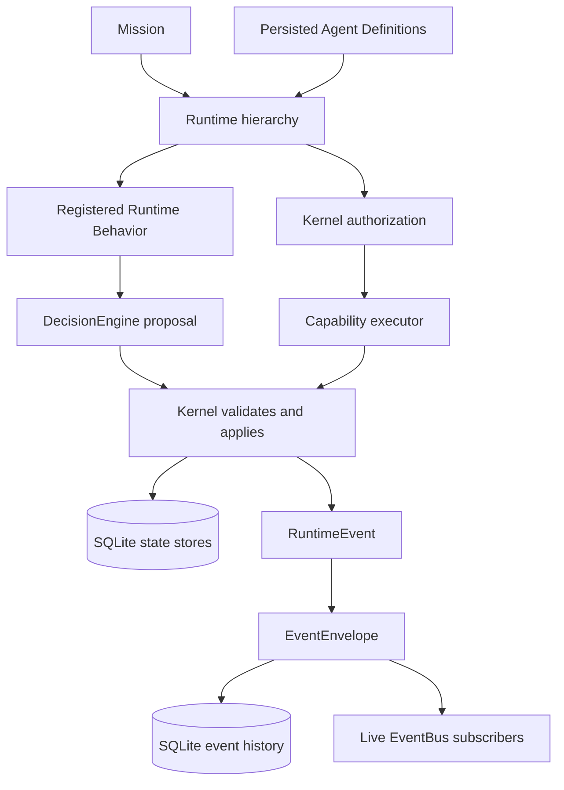

# WyvernOS

WyvernOS is a local-first AI orchestration and control-plane runtime. It coordinates persistent missions and recursive runtime instances while keeping lifecycle management, context propagation, scheduling, capabilities, and persistence in deterministic software.

WyvernOS is not an LLM. Models are external decision or reasoning providers. The runtime kernel owns identity, lifecycle, hierarchy, persistence, scheduling, context and memory boundaries, capability boundaries, decision validation and application, behavior execution, authorization checks, and event history. This repository implements the control-plane foundations through Stage 7A; it does not yet include model routing or Laya.

## Architectural model

An **Agent Definition** is a reusable identity and role to which a behavior can be bound. A **Runtime** is one concrete execution instance of an agent, with its own objective, mission, lifecycle state, parent/child relationships, and result.

```text
Agent Definition ──bound to──> Runtime Behavior
                                    │
Mission ──> Root Runtime ──> Child Runtime(s)
                  │                 │
                  ├── local context and selected inherited context
                  ├── selected memory and capability results
                  ├── decision proposal ──> Kernel validation/application
                  └── execution and structured results
```

The kernel controls runtime state transitions. A `DecisionEngine` receives a typed request with explicit options and selected context, and proposes a result. The kernel checks the proposal and applies supported lifecycle decisions. A `RuntimeBehavior` runs through a bounded runtime handle and can request work through the kernel; it does not own lifecycle state.

The main persistence and event paths are:



SQLite backs mission, agent, runtime, event, context, memory, and scheduler records. These stores share a local database path in the SQLite-backed Kernel setup, but their updates are not one transactionally unified operation.

## Implemented stages

### Stage 1 — Runtime Kernel

Implemented typed mission, runtime, and agent IDs; lifecycle state validation; mission tracking; recursive parent/child runtimes; concurrent execution; cancellation and failure handling; SQLite persistence and startup hydration; runtime events; a deterministic demo executor; and CLI inspection.

### Stage 2 — Context and State Infrastructure

`RuntimeContext` is separate from machine execution state. `ContextCompiler` deterministically assembles explicitly supplied inputs, including runtime state, local facts, selected inherited facts, events, child outputs, constraints, metadata, selected memories, and capability results. Context items retain provenance. Context is branch-local, stored by runtime, and has persisted versioned snapshots. Child results and inherited context are passed explicitly; they do not become global context automatically.

### Stage 3 — Scoped Memory

Memory is typed, durable structured state with scope, provenance, status, and lifecycle operations such as superseding, invalidating, archiving, and promotion. Runtimes receive memory only when a caller explicitly selects it into context. This is not vector or semantic memory: there are no embeddings, semantic search, or automatic summaries.

### Stage 4 — Capability Boundary

The capability module provides typed capability, tool, and request IDs; descriptors with input/output schemas and risk metadata; a registry and executor interface; typed requests and results; and request lifecycle events. Callers explicitly select results for context or convert successful results into memory drafts.

`mock.echo` is a test executor; no production browser, filesystem, process, network, model, or OS executor is registered by default. Kernel-owned durable grants are described under Stage 7A below.

### Stage 5 — Scheduler

The local scheduler coordinates existing runtimes using bounded asynchronous workers, persistent queue state, deterministic priority with age-based fairness, dependencies, retry budgets with backoff, waiting and resume, cancellation, timeout handling, and scheduler events. SQLite claims use conditional state updates. On restart, work left in `Running` is marked interrupted rather than automatically resumed. This is a local scheduler, not a distributed service.

### Stage 6A — Model-Agnostic Decision Engine

The `DecisionEngine` trait accepts typed `DecisionRequest` values and returns typed `DecisionResult` proposals with engine provenance. Requests define the available options and explicitly selected context. `MockDecisionEngine` is deterministic. The engine proposes; it does not own or mutate runtime state.

### Stage 6B — Bounded Decision Application

The kernel currently applies the bounded `RuntimeLifecycle` decision type. It validates that the selected option was offered, that the requested transition is legal, and that the runtime has not changed since the request was built. State application uses a compare-and-set check over lifecycle state and `updated_at`. Results distinguish accepted applications from rejected or stale proposals. Decision application remains kernel-controlled.

### Stage 6C — Pluggable Agent Behavior

`RuntimeBehavior` implementations are registered in a `RuntimeBehaviorRegistry` and resolved by `AgentId`. Behaviors receive a bounded `BehaviorRuntimeHandle`; direct and scheduled execution use the same behavior-backed executor path. The kernel retains lifecycle authority. The repository includes deterministic Commander and Worker demo behaviors. Behavior implementations are in-process and are not persisted as executable objects; after restart, the current process must provide behavior registrations (kind defaults can be rebound during hydration).

### Stage 6D — Durable Agent Identity and Event Log

**Agent identity:** SQLite stores `agent_id`, `name`, `kind`, and `created_at`. Startup hydrates agent definitions before missions and runtimes. A recovered runtime must resolve its persisted `AgentId`; a missing identity produces a typed error. WyvernOS rejects duplicate agent IDs and does not synthesize replacement agents during recovery.

**Event history:** With persistent storage configured, publishing a `RuntimeEvent` creates an `EventEnvelope`, appends it to SQLite, and then broadcasts it to live subscribers. The envelope includes a typed UUIDv7 `EventId`, event type, timestamp, mission ID, runtime ID, parent runtime ID, and typed serialized event payload. The SQLite row also receives an ordered `sequence_id`. Recovery validates that persisted envelope metadata agrees with its payload.

The kernel exposes history queries for all persisted events, one runtime, or one mission. `EventBus` remains the live asynchronous broadcast mechanism; the durable event log is a separate historical inspection mechanism.

### Stage 7A — Kernel-Owned Authorization

The kernel issues and persists typed authorization grants. A grant records its ID, issuer, subject `AgentId`, capability, allowed tools, mission or runtime scope, maximum permitted tool risk, issue time, optional expiration, and revocation time. A capability caller can select a grant ID on its request, but that ID is only a reference: the kernel loads and checks the durable grant, resolves the agent from the runtime, and obtains risk from the registered `ToolDescriptor`. The caller cannot pass a constructed permission object or authorization decision to the executor.

Checks reject missing or unknown grants, a different agent, capability, tool or scope, excessive risk, expired grants, and revoked grants. Grant issuance and revocation are exposed through explicit kernel management methods and produce durable authorization events through the existing EventBus/event log. Stage 7A tests cover invocation decisions, expiry, revocation, restart recovery, and event history.

This is an authorization foundation, not a production identity system. The current management API permits runtime-mediated issuance only and binds a runtime issuer to the issuing runtime; WyvernOS does not authenticate human/operator accounts. Grant writes and their corresponding event appends are separate operations until the planned atomic persistence work in Stage 7B.

## Context, memory, and events

These concepts have separate roles:

| Component | Role |
| --- | --- |
| Runtime state | Machine-readable execution identity, hierarchy, lifecycle, and result |
| Context | A runtime-specific projection of explicitly selected information |
| Memory | Durable, scoped structured records that may be selected into context |
| EventBus | Live asynchronous event delivery to subscribers |
| Event log | Durable ordered event history for inspection |

The compiler is deterministic and has no hidden global lookup. Sibling branches do not see each other’s local context unless a commanding runtime explicitly propagates information. Context snapshots are immutable records with per-runtime versions and optional parent-snapshot metadata.

## Persistence and recovery

The SQLite-backed kernel stores missions, agents, runtimes and results, event history, context and snapshots, memory records, and scheduler state. Startup hydration follows dependency order:

```text
Agents → Missions → Runtimes → runtime hierarchy and context
```

Agents load first because runtimes refer to them by `AgentId`. Runtime records remain the source used to recover runtime state; the event log is not replayed to reconstruct state. Versioned SQLite runtime lifecycle transitions and their state-change event appends are committed in one transaction and the committed envelope is broadcast live. Other state mutations and event types remain separate persistence operations, so this is not yet a transactional guarantee across every subsystem.

## Current boundaries

Stages 1–7A establish local orchestration infrastructure. They do not implement event sourcing or replay-driven state reconstruction, atomic state/event commits, distributed event storage, distributed runtimes, multi-node orchestration, or persistent executable behavior objects and dynamic behavior loading. Model routing, Laya, real browser automation, and production tool execution remain outside the current implementation. Stage 7A does not provide authenticated operator identities or production-grade authorization policy management.

The decision and behavior interfaces are extension points, not model integrations. The capability boundary is not a complete security system. The project is not an operating-system kernel and does not provide unrestricted computer control.

## Roadmap

Stages 1–6D, Stage 7A, and Stage 7D are implemented. The next planned work is:

1. **Stage 7B — Atomic state and event consistency:** extend the SQLite runtime transition transaction to the remaining critical mutations and failure-injection coverage.
2. **Stage 7C — Scheduler hardening:** reconcile terminal recovery state, then address remaining race, fairness, and concurrency edge cases.
3. **Stage 8 — Skill integration:** define contracts and registry, bridge adapters through capabilities, and demonstrate runtime orchestration.
5. **Stage 9 — Specialized decision intelligence:** formalize the decision dataset, distill teacher labels, evaluate a specialized Laya `DecisionEngine`, then add conservative local/cloud routing. Kaggle is the preferred GPU training environment for the Stage 9 experiments; authentication and held-out evaluation requirements are documented in the project plan.
6. **Later work:** TUI, broader application control, deeper recovery, Linux integration, and other roadmap items.

These are roadmap items, not implemented capabilities. See [ROADMAP.md](ROADMAP.md) and [ARCHITECTURE.md](ARCHITECTURE.md) for project planning and component boundaries.

## Tests

Stage-specific integration tests cover the implemented architecture from the runtime kernel through Stage 7A. Stage 6D tests exercise agent persistence and identity preservation, runtime hierarchy recovery, duplicate-agent rejection, event persistence and ordering, unique event IDs, runtime and mission filters, and persisted decision events. Stage 7A tests cover grant validation, agent/runtime/capability/tool/scope/risk matching, unauthorized and authorized invocation, expiration, revocation, SQLite recovery, duplicate grants, and authorization events. Other stage tests cover context and snapshots, scoped memory, scheduler coordination, decision validation, and behavior execution.

Run the focused authorization checks with `cargo test --test stage7a`, or run the complete Rust checks and test suite with:

```bash
cargo fmt --check
cargo check
cargo test
```

The project is under active development; tests describe current contracts and do not imply production readiness or distributed-operation guarantees.

## Repository layout

```text
src/
  behavior/     Runtime behavior interface, registry, and deterministic demos
  capability/  Capability and tool descriptors, registry, and executor boundary
  context/      Runtime context compiler, store, and snapshots
  decision/     Typed decision requests, results, and engine interface
  memory/       Scoped durable structured memory
  persistence.rs SQLite persistence contracts and runtime store
  scheduler.rs  Local bounded execution coordinator
  kernel.rs     Runtime hierarchy, lifecycle, and subsystem coordination
tests/          Stage-specific integration tests
```
