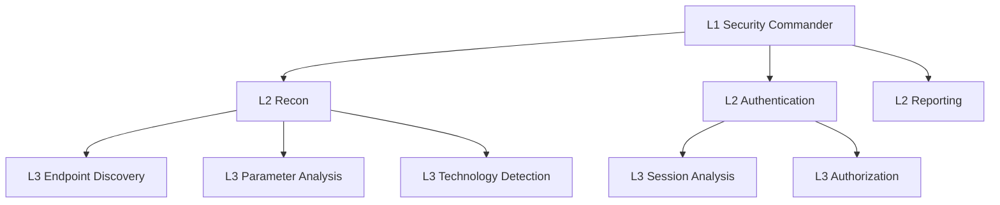
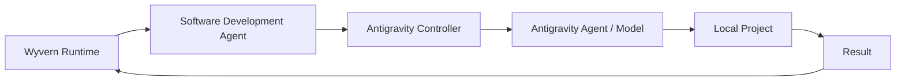
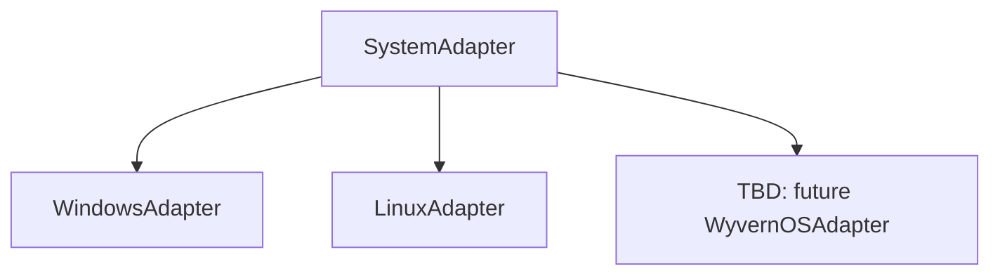

# Wyvern

Wyvern is a local-first, AI-native orchestration and control system. It is not a chatbot, a single agent, or a single model wrapper. The project is intended to become a persistent runtime layer that coordinates specialized agent runtimes, tools, external reasoning models, local applications, browsers, terminals, IDEs, filesystems, security tools, and eventually deeper operating-system capabilities.

This repository currently defines the architecture and staged implementation plan only. The runtime engine itself is intentionally not implemented yet.

## Vision

Wyvern aims to become a command-and-control layer for software work and system work on a local machine. The long-term goal is a deterministic orchestration kernel that can manage many logical runtimes concurrently while routing reasoning, tool use, and external agent delegation through explicit abstractions.

The system should be able to:

- receive user commands
- manage multiple missions at once
- spawn and supervise recursive child runtimes
- compile task-specific context rather than exposing global state indiscriminately
- keep memory scoped and provenance-aware
- coordinate decision-making separately from reasoning
- expose live status through a TUI and CLI
- evolve toward a Linux-native control plane without requiring a rewrite

## Core Architectural Concepts

Wyvern is built around a persistent root runtime and recursively spawned child runtimes.

Agent Definition
→ Runtime Instance
→ Objective
→ Context
→ Decision
→ Tools / Child Runtimes
→ Observation
→ State Update
→ Memory Update
→ Result
→ Parent Runtime
→ Termination

The same runtime implementation should be able to operate at L1, L2, L3, L4, and deeper levels. A runtime may finish its task directly or spawn children if additional workforce is needed.

### Agent vs Runtime

An agent is a reusable role or capability definition. A runtime is a concrete execution instance of an agent working against a specific objective within a specific context and mission.

This distinction matters because agents are reusable definitions, while runtimes are ephemeral executions with state, progress, events, and lineage.

### Recursive Runtime Hierarchy

Example hierarchy:

Child runtimes report structured results to their immediate parent. Parents synthesize relevant state and propagate only what matters upward.

## Context Compiler

Context is hierarchical and dynamically compiled. A runtime should receive only the information relevant to its responsibility.

The context compiler may draw from:

- parent objective
- runtime objective
- branch state
- mission state
- prior attempts
- findings
- dependencies
- artifacts
- constraints
- capabilities
- permissions
- relevant memory
- relevant child results

The compiler must not blindly provide the entire global state to an LLM.

## Memory Architecture

Memory must be scoped. Operational details should not automatically become permanent knowledge, and important findings must preserve provenance and lineage.

Planned memory scopes include:

- runtime memory
- branch memory
- mission memory
- reusable/global knowledge

Memory entries should carry:

- scope
- source runtime
- timestamp
- relevance
- confidence where appropriate
- evidence or artifact references
- relationship to mission or branch

Negative results matter too. If a child runtime proves a hypothesis false within a branch, that result should be recorded with evidence so that sibling work does not repeat the same failure unnecessarily.

## Event Architecture

Wyvern should be event-driven. Events are the primary mechanism for runtime coordination, live UI updates, observability, auditability, recovery, and parent/child synchronization.

Planned event types include:

- runtime.created
- runtime.started
- runtime.waiting
- runtime.progress
- runtime.spawned_child
- runtime.tool_called
- runtime.tool_completed
- runtime.reasoning_requested
- runtime.reasoning_completed
- runtime.memory_updated
- runtime.failed
- runtime.completed
- runtime.cancelled

## Decision vs Reasoning

Wyvern should not make every decision through an LLM.

The runtime should have a deterministic decision layer for frequent, cheap control-flow choices such as continue, wait, retry, spawn, skip, escalate, and terminate. More complex reasoning should be delegated through a model routing interface.

## Laya

Laya is the planned fast local decision component. It should eventually handle cheap, frequent decisions and deterministic branching while remaining separate from reasoning logic.

## Model Router

The runtime must never hard-code a specific model. Reasoning requests should go through a model router that can select providers according to policy.

Potential provider policies include:

- cheap / fast reasoning
- complex reasoning
- coding
- vision
- research
- security reasoning
- local inference
- cloud inference

## Tools

Wyvern should operate existing local software rather than reinventing everything. Agents should interact with controlled tool interfaces rather than coupling directly to terminals, browsers, filesystems, or applications.

Planned future tools include:

- filesystem
- terminal
- browser
- browser tabs
- HTTP
- Git
- process management
- screenshots
- IDE control
- application control
- security tools
- OS APIs

## Skills

Skills are reusable task-specific capability packages. They are not necessarily custom models; they are role and capability definitions that can load tools and reasoning providers at runtime.

Examples include:

- browser automation
- web research
- software development
- Python development
- Rust development
- SQL analysis
- security reconnaissance
- vulnerability validation
- report writing
- academic research
- IDE operation
- Antigravity operation

## External Agent Integration

Wyvern should eventually be able to command other agent-capable software instead of reproducing every subsystem itself.

Conceptually:

Browser work should likewise use browser-specific agents or tools rather than the root runtime directly manipulating every browser operation.

## TUI Vision

Wyvern should eventually provide a TUI, not only a command line interface. The TUI should subscribe to orchestration state and events rather than duplicating the orchestration logic.

Planned views include:

- branding and header
- command input
- active missions
- active runtimes
- runtime hierarchy
- agent status
- live event stream
- CPU, RAM, GPU, VRAM, and network activity
- runtime counts
- model / API activity
- mission state

The CLI should remain available for scripting and automation.

## OS Evolution

Wyvern is intended to begin as a control plane on an existing operating system and later evolve toward a deeply integrated Linux environment. Linux remains the underlying operating system; Wyvern is not a kernel project.

Planned progression:

1. Wyvern runtime on an existing OS
2. Wyvern as a deeply integrated Linux environment
3. Wyvern-oriented Linux distribution or AI-native OS environment

System-specific behavior should be isolated behind adapters such as:

## Security Principles

Security is a first-class architectural concern, but v0.1 is not intended to include a full production security stack.

Principles for the project:

- favor explicit permissions over implicit access
- isolate tools behind controlled interfaces
- scope memory and context carefully
- preserve provenance for important facts
- keep risky capabilities behind clear boundaries
- use deterministic control flow whenever possible
- treat external reasoning and external agents as untrusted boundaries unless explicitly constrained

## Development Philosophy

Wyvern should be built as a small reliable kernel first.

The most important principle is that Wyvern's fundamental behavior should be deterministic software wherever possible. LLMs should provide reasoning where reasoning is required, not replace lifecycle management, scheduling, persistence, event handling, or communication.

Do not add abstractions just because the system might scale in theory. Build the minimum coherent orchestration kernel first, then expand carefully.

## Stage Roadmap

This repository is currently in Stage 0.

### Stage 0 - Repository / Architecture

Status: planned and in progress for this repository bootstrap.

Create repository structure, documentation, architecture diagrams, contracts, design decisions, and development rules. No runtime implementation yet.

### Stage 1 - Runtime Kernel

Implement the runtime structure, agent definition, runtime lifecycle, parent/child hierarchy, async execution, basic scheduler, and basic state persistence.

### Stage 2 - Event System

Implement the event bus, event definitions, subscriptions, runtime events, live event stream, and persistence / audit trail.

### Stage 3 - Context + Memory

Implement the context compiler, scoped memory, mission state, branch state, runtime state, artifact references, relevance filtering, and provenance.

### Stage 4 - Tool System

Implement common tool interfaces and begin with safe basic tools: filesystem, terminal, and process execution.

### Stage 5 - Model Router

Add external reasoning API support through a provider abstraction. No model should be hard-coded into the runtime engine.

### Stage 6 - Laya Integration

Add Laya as a fast decision provider while keeping decision logic separate from reasoning logic.

### Stage 7 - TUI

Build the Ratatui interface with mission view, runtime tree, agent view, event stream, system monitoring, model activity, and command input.

### Stage 8 - Browser / Application Control

Add controlled interfaces for browser, tabs, filesystem, IDEs, and applications.

### Stage 9 - Skills

Create the skill registry and skill loading system.

### Stage 10 - Advanced Agents

Build reusable agent definitions for research, coding, browser automation, security, academic work, reporting, and validation.

### Stage 11 - Reliability

Implement retries, crash recovery, runtime restoration, cancellation, timeouts, dependency handling, checkpointing, graceful shutdown, and mission resumption.

### Stage 12 - Deep OS Integration

After the core architecture is stable, add Linux system integration, process management, sandboxing, permissions, resource control, isolation, and system services.

### Stage 13 - Wyvern Linux Environment

Explore a minimal Linux environment or distribution where Wyvern becomes the primary AI orchestration and control layer.

## Non-Goals for v0.1

Wyvern v0.1 will not attempt to build:

- a custom LLM
- an operating system
- a kernel
- a full desktop environment
- hundreds of agents
- every browser integration
- every IDE integration
- distributed cloud infrastructure
- autonomous unrestricted computer control
- complex production security infrastructure

The goal is to prove the runtime kernel.

## Current Status

Stage 0 only.

The repository now captures the system's architecture and development plan. The runtime engine, event bus, context compiler, memory system, tool system, model router, and TUI are intentionally not implemented yet.

## Future Architecture Diagrams

Future documentation should expand with diagrams for:

- runtime lifecycle state transitions
- event propagation and subscriptions
- context compilation flow
- memory scope relationships
- model routing policy selection
- tool access boundaries
- TUI data flow
- mission / runtime hierarchy
